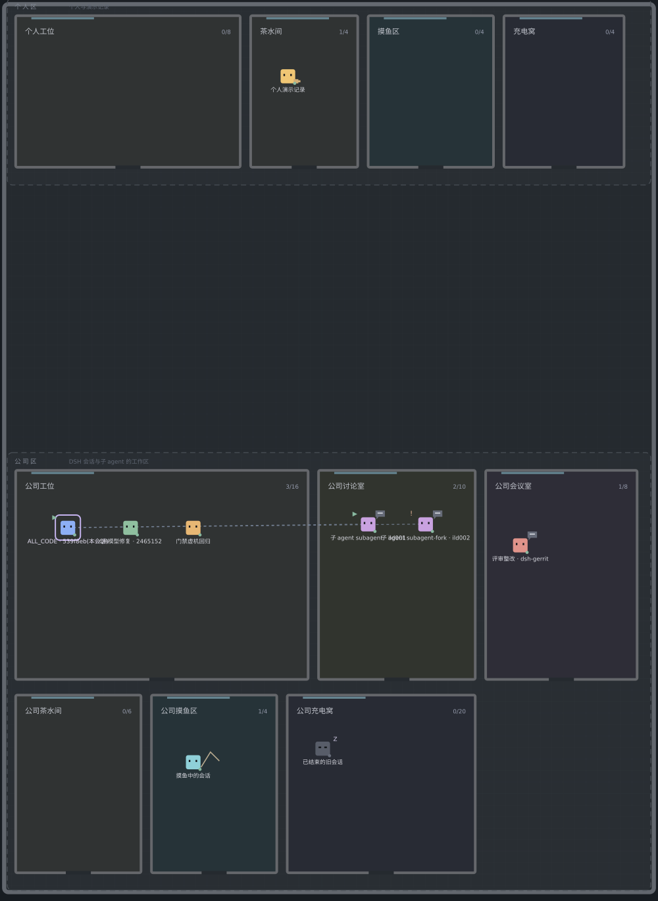

<h1 align="center">dsh-bit-office</h1>

<p align="center">
让每个 DSH 会话和子 agent 都在 <a href="https://github.com/hekmon8/bit-office">bit-office</a> 办公室里有一个小人：<br/>
自动登记、实时状态、会话标题栏里一张可看的平面图。
<br/><br/>


</p>



*上图由 `node scripts/make-preview.mjs` 用**同一份纯函数渲染器**生成（不是截图），紫色高亮环是当前会话，
虚线是 subagent 的父子/委托关系，`zzz` 是已离线记录。*

## 它做什么

DSH 会话 = 办公室里的一个 agent。装上这个插件后：

1. **自动同步（不依赖模型调工具）**——监听 `session/created`、`session/disposed`、`subagent/start`、`subagent/end`，
   把每个会话、每个子 agent 映射成 bit-office 的一条记录；名字取会话标题，子 agent 自动挂到父会话下面。
2. **两个工具**——模型可以（但不是必须）用 `bit_office_report` 上报自己在干什么、在跑什么任务。
3. **会话标题栏「办公室」标签页**——同源只读路由 `GET /api/dsh-bit-office/state` 喂数据，10 秒轮询（页面不可见时暂停），
   画成平面图：分区色带 + 房间占用数 + 每个 agent 一只像素宠物 + 当前会话高亮。
4. **一行系统提示**——每次请求注入 3~5 行短约定，告诉模型有这么个办公室、可以怎么上报。

## 安装

本插件随 **[hekmon8/bit-office](https://github.com/hekmon8/bit-office)** 一起开源，源码在 `plugins/dsh-bit-office/`。monorepo 子目录用 `&path:/<子目录>` 语法安装：

```bash
dsh plugin --profile web add "github:hekmon8/bit-office#<commit-sha>&path:/plugins/dsh-bit-office"
```

本地开发/试装可以直接给目录（`link:` 安装，改完刷新即可）：

```bash
dsh plugin --profile web add /path/to/bit-office/plugins/dsh-bit-office
```

构建产物（`lib/`）已入库，git 源安装不需要额外构建步骤。装完**重启 dsh web**（bundle 层栈改动需要重启；这是官方 bundle 插件的既定行为）。
首次使用需要 token（见下），未配置 token 时插件照常挂载，只是所有远端调用会失败并只写日志。

## 配置

优先级：环境变量 > `~/.dsh/dsh-bit-office.json` > 内置默认值。

| 键 | 环境变量 | 默认 | 说明 |
|---|---|---|---|
| `url` | `BIT_OFFICE_MCP_URL` | `https://agents.hekmon.com/mcp` | bit-office MCP 端点 |
| `token` | `BIT_OFFICE_MCP_TOKEN` | 空 | Bearer token；**只从 env/配置文件读，仓库里不留任何 token** |
| `zoneId` | `BIT_OFFICE_ZONE` | `office` | 新建记录落到哪个分区 |
| `retentionMs` | `BIT_OFFICE_RETENTION_MS` | `900000`（15 min） | 子 agent 结束后延迟多久软退休 |
| `throttleMs` | `BIT_OFFICE_THROTTLE_MS` | `60000` | 同一 agent 状态上报的最小间隔 |
| `cacheMs` | `BIT_OFFICE_CACHE_MS` | `5000` | 路由侧状态缓存（标签页轮询不打爆远端） |
| `timeoutMs` | `BIT_OFFICE_TIMEOUT_MS` | `15000` | 单次 MCP 调用超时 |
| `enabled` | `BIT_OFFICE_ENABLED` | `true` | 关掉后只挂载工具与标签页，不写远端 |
| `logLevel` | `BIT_OFFICE_LOG` | `info` | `silent`/`info`/`debug` |

```json
// ~/.dsh/dsh-bit-office.json
{ "token": "<你的 bit-office MCP token>" }
```

## 能力面

### Tools

| 工具 | 说明 |
|---|---|
| `bit_office_report` | 会话主动上报自己的状态（activity/task/blocked/note）；例：`{"activity":"meeting","task_id":"t1","task_title":"和评审对齐","status":"running"}` |
| `bit_office_state` | 读当前办公室全貌（分区/房间/agent/任务/退休计数），用于回答「办公室现在什么情况」 |

### Client（浏览器 UI）

| 槽 | id | 说明 |
|---|---|---|
| `conversation.view` | `office` | 会话标题栏「办公室」标签页：平面图 + 统计 + 图例；10s 轮询、页面隐藏暂停、当前会话高亮 |

### HTTP 路由（同源只读）

| 方法 | 路径 | 说明 |
|---|---|---|
| GET | `/api/dsh-bit-office/state`（可带 `?session=<会话 id>`） | 返回 `{fetchedAt, stale, error, session, office:{zones,rooms,agents,retiredCount}, stats, local}`；远端不可用时也返回 200 + `stale:true`，标签页显示降级态而不是白屏 |

### Skills / MCP servers

| 面 | 说明 |
|---|---|
| Skills | 无（插件本体不含 skill） |
| MCP servers | 无（插件是 MCP **客户端**：对接远端 bit-office MCP，不对外暴露 server） |

### 生命周期事件（自动同步的接线）

| 事件 | 动作 |
|---|---|
| `session/created` | `create_agent`（`agent_id` = 会话 id、`zone_id` = office、名字 = 会话标题）+ `update_agent_status{working,online,heartbeat}` |
| `session/disposed` | `retire_agent{cascade:true}`（旧部署降级为 `offline` + `tasks_complete`） |
| `subagent/start` | 子记录 `parent_id` = 父会话 agent_id、`activity='discussing'` |
| `subagent/end` | `offline` + 一条终态 task（含 provider/stopReason）；`retentionMs` 后 `retire_agent` |

## 与 bit-office 的关系

| 方面 | 说明 |
|---|---|
| 依赖 | 插件**不 import** bit-office 仓库任何代码，只通过远端 MCP 对话 |
| 视觉 | 平面图配色/宠物造型对齐 bit-office（地板 `#252a2f`、房间描边 `#65676b`、宠物 = 方块 + 眼睛），由本仓库 `src/floorplan.mjs` 独立实现 |
| 新契约 | 兼容已部署的 8 个工具；对尚未部署的 `retire_agent` / `zone_id` / `parent_id` / `include_retired` / `zones[]` 做**能力探测 + 优雅降级**（被拒就剥掉字段重试，并记住「不支持」不再重试） |

## 兼容性与降级

- **乐观锁**：写前读 `revision`，写时带上；遇 `revision_conflict` 重读后重试（最多 2 次），仍失败就放弃本次并记日志。
- **能力探测**：工具/字段被拒 → 记进 `missingTools`/`supportsZone` 等标志位，后续请求不再发送这些字段；`retire_agent` 不可用时降级为 `offline` + 任务终结。
- **失败隔离**：任何网络/协议错误都只写日志，**不会**抛出到会话事件回调、不会阻塞会话；同一 agent 的写操作串行化。
- **只在插件边界内动作**：不改 profile 配置、不改宿主、不改 bit-office 仓库（`scripts/gates.mjs` 与决策记录 001/003 锁死这些约束）。

## 开发

```bash
node scripts/build-client.mjs       # 从 src/ 重建 lib/client.js（生成物，勿手改）
node scripts/build-client.mjs --check   # 只校验新鲜度
node scripts/gates.mjs              # 门禁：包契约 / patch 层 / 产物新鲜度 / inject 覆盖 / 禁止依赖 / 无密钥
node --test "test/**/*.test.mjs"    # 自证测试（99 条，含本地 mock MCP server）
node scripts/make-preview.mjs       # 重新生成 docs/preview/floorplan.svg
```

### 自证测试覆盖什么

| 测试文件 | 覆盖 |
|---|---|
| `test/mcp.test.mjs` | 请求构造（headers/notification/SSE 与纯 JSON 两种响应）、错误码归一（`ToolUnavailable`/`InvalidParams`/`revision_conflict`/`agent_exists`/HTTP 500/传输失败） |
| `test/office.test.mjs` | 乐观锁冲突重读重试、重试耗尽、`agent_exists` 改走 update、新契约字段被拒后的降级、软退休与降级退休、`include_retired` 回退 |
| `test/mapping.test.mjs` | 会话 → 记录字段映射（agent_id/zone/名字回退「目录名 · 会话 id 后 6 位」）、子 agent → `parent_id`、终态任务标题 |
| `test/sync.test.mjs` | 保留期调度（可推进的假时钟：提前 1ms 不退休、到点退休）、节流与 `force`、per-agent 串行、失败只记日志、缓存与 `stale` |
| `test/floorplan.test.mjs` | 布局（分区/占用归集/兜底房间/退休可见）与 SVG（配色/宠物/连线/高亮/XML 转义/幂等/idPrefix） |
| `test/client.test.mjs` | 在最小 React 运行时 + 假 DOM 里跑**入库产物** `lib/client.js`：槽注册（name/id/order/label）、请求 URL、10s 轮询、隐藏暂停、渲染出的 SVG、错误态、卸载清理 |
| `test/entry.test.mjs` | Cordis entry：`inject` 名单、工具 schema 形状、3~5 行提示、路由注册与返回体、四类事件接线、服务缺失/严格注入抛错时仍能挂载、`mergeOffice` 合并语义 |
| `test/gates.test.mjs` | 每条门禁都用非法样例证明「真的会拒绝」（门禁自证） |

测试用**本地 mock MCP server**（`test/mock-mcp.mjs`，node:http，SSE + JSON 双传输，可注入冲突/重名/缺工具/HTTP 失败），
不依赖真实网络，`npm test` 零依赖（只用 Node 标准库 + `node:test`）。

## 已知取舍与未验证项

诚实记录，便于下一位维护者接手：

- **工具定义是本地实现的**（不是官方 `defineTool`）：bundle 插件以 `link:` 安装时解析不到宿主 `@deepseek-ai/*` 包，见决策记录 001。
- **标签页 label 是静态的** `() => '办公室'`（没有实时人数）。官方槽的 label 在注册后不刷新，做动态 label 需要「注销 + 重注册」；为降低与真实内核的耦合风险，本期刻意不做（skill `conversation-view-tab.md` §6）。
- **真机挂载已冒烟通过**（2026-10-14 在独立的临时 profile 里实测）：两个工具注册成功、状态路由注册并返回 200、远端不可达时降级为 `stale:true` 且不影响宿主启动、client bundle 出现在 GUI 插件列表且无 console 错误。
- **仍未验证的两点**：① 对真实 `https://agents.hekmon.com/mcp` 的端到端（当时线上还是旧契约、且未注入 token，只跑通了本地 mock 与降级路径）——待 bit-office 新版部署后补；② 在真实会话标题栏点开「办公室」标签页看平面图渲染（需要真实会话 + 重启 dsh web）。
- **本机 web profile 未安装本插件**（保持现有 profile 配置不动）。
- **子 agent 的父会话**取自子会话 `header.parentSession`；解析不到时只建**不带 parent** 的记录并记日志（不会猜父会话）。
- 会话已结束但保留期内的记录**故意保留**（便于看到刚结束的子 agent 与终态任务），可用 `retentionMs` 调整。

## 插件管理

已装插件用 plugin-registry 的**薄控制台**管理（浏览器面板）：管理 profile 插件安装态（bundle 层栈 + insert 行 + 启停），无需手改配置。安装：

```bash
dsh plugin --profile web add <plugin-registry>/packages/plugin/console
```

## 目录结构

```
lib/             Node half（Cordis entry / MCP 客户端 / 业务 API / 同步器 / 工具定义）
src/floorplan.mjs  零依赖纯函数：状态 JSON → 平面图 SVG（Node 与浏览器共用）
src/client.template.js  client half 模板（构建期内联 floorplan.mjs）
lib/client.js   生成物：浏览器 bundle（勿手改）
scripts/        build-client.mjs（构建+新鲜度门禁）/ gates.mjs / make-preview.mjs
test/           自证测试 + 本地 mock MCP server
decisions/      决策记录（每个非平凡改动的 Problem/Decision/Alternatives/Consequences）
docs/preview/   README 预览图（由脚本生成）
```

## License

MIT
